# Design references

**The design is done** (brainstorm decision 14). It is the DEBUG design used for the school edition; the student
edition only replaces branding and the auth screens. Agents must build from these references and never invent a
new look. Full specification: [`docs/debug-2026-design.md`](../docs/debug-2026-design.md). Original live site
(school edition): https://debug-2026.vercel.app.

## Concept

**The site is a debugger session**: a gutter with line numbers on the left, a breakpoint marker that follows the
scroll, syntax-coloured kickers (`// ...`), a terminal card for registration (`./register.sh`), console output for the
participant list (`[0042] Тегі Аты`), a paused-process countdown. Calm, precise, technical. One bold colour only.

## Tokens

| Token | Value | Use |
|---|---|---|
| `--ground` | `#070b10` | page background (dark only — no light theme) |
| `--panel` / `--panel-2` | `#0e1620` / `#111b26` | cards, terminal title bars |
| `--hairline` / `--hairline-soft` | `#1a2632` / `#131d27` | borders, grid lines |
| `--text` / `--title` | `#dce7ef` / `#f2f8fc` | body / headings |
| `--muted` / `--dim` | `#6e869b` / `#41566a` | secondary text / labels |
| `--accent` | `#34e0c4` | the only bold colour: buttons, active states, logo |
| `--warn` / `--violet` / `--err` | `#f2a93b` / `#9b7bff` / `#ff5c7a` | countdown digits, accents in the logo grid, errors |
| `--mono` | JetBrains Mono KZ (self-hosted v2.304, has Ә Ғ Қ Ң Ұ Һ) | everything by default |
| `--sans` | IBM Plex Sans 400 (self-hosted, cyrillic-ext has Kazakh letters) | lead paragraphs and notes only |
| `--pad` | `clamp(18px, 3.4vw, 56px)` | page side padding |

## Components (vocabulary)

- **Kicker** — `// ТЕКСТ`, 11 px, uppercase, accent, `//` in dim. Decodes from random glyphs on load (`app/ui/Decode.tsx`).
- **Terminal card** — `.card` with a `.card-head` bar (three dots or tabs + `~/debug/<file>.sh` on the right).
- **Auth tabs** — two pill tabs «Кіру / Тіркелу» inside the card head; the active one is accent-outlined.
- **Field** — uppercase accent label, 46 px input, red border + focus ring when `aria-invalid`.
- **Buttons** — `.btn` accent, uppercase, sweep shine on hover (fine pointers only); `.btn-ghost` outlined; `.is-busy` running bar.
- **Chips / pills** — round outlined labels (`6 тіркелді`, round status, «тыйым: set(»).
- **Countdown** — four panel cells with amber digits.
- **Leaderboard rows** — rank, «Тегі Аты», delta arrow, score; big empty-state text with a note.

## Logo

Block-grid wordmark **`DEBUG_`**: every stroke is one 6-unit block, letters 24×30, 6-unit gaps, viewBox `0 0 168 30`,
outer curves r = 9, inner r = 3. The cursor block (`M150 24H168V30H150Z`) blinks in the header
(`steps(1)`, 1.1 s; off with `prefers-reduced-motion`). Colours: accent in the header/leaderboard, `--dim` in the footer.
The «Бренд» act builds the logo from a 28 × 5 grid of cells — one cell per stroke block, so blocks land exactly on
the letters. Favicon: the `D` on a `#0e1620` rounded square (`public/favicon.svg`).

## Motion rules

- Animate **transform and opacity only**; one-shot effects (enter, shake, pop); nothing loops except the cursor and the code rain.
- `prefers-reduced-motion: reduce` turns animations off.
- Hover effects only under `(hover: hover) and (pointer: fine)`.
- Pause work off-screen (IntersectionObserver) and when the tab is hidden.
- `.enter` animations belong on a wrapper that never re-mounts (a re-mount replays them and flashes the screen).

## Screens

| Screen | Reference |
|---|---|
| Logo sheet (sizes, grid) | 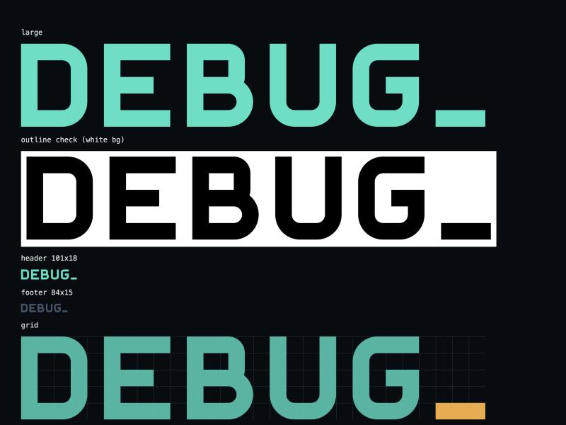 |
| Landing — hero | 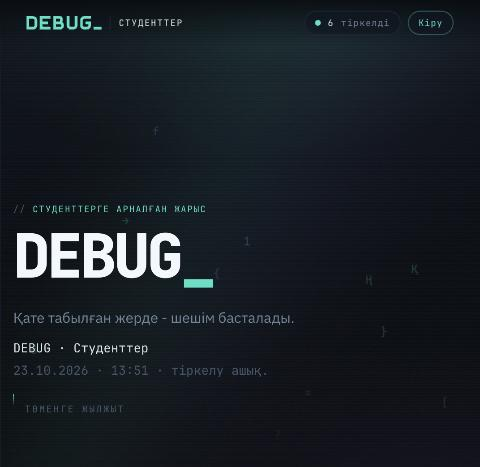 |
| Landing — «Бренд» logo build | 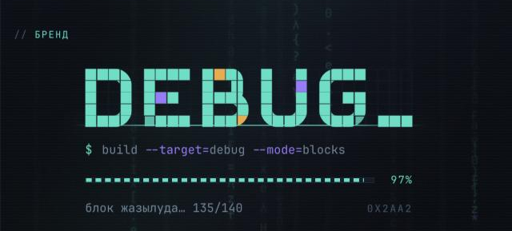 |
| Landing — countdown + registration panel | 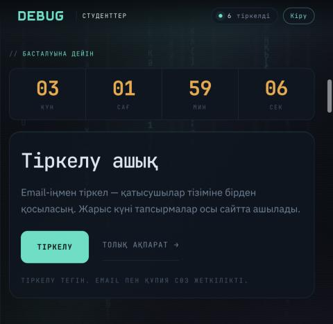 |
| Landing — `./register.sh` terminal | 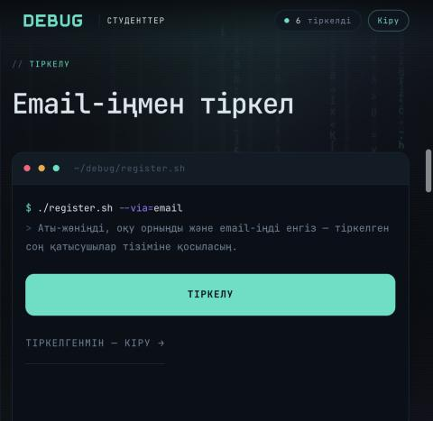 |
| Landing — participant list | 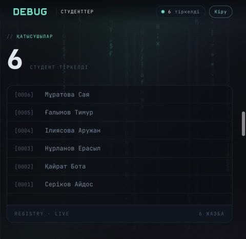 |
| Landing — prizes | 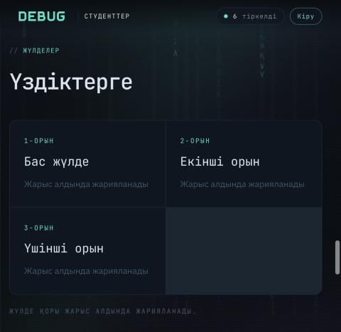 |
| Login | 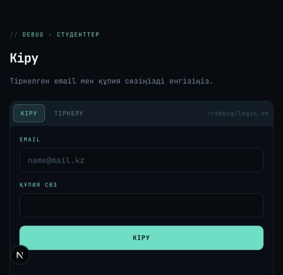 |
| Registration | 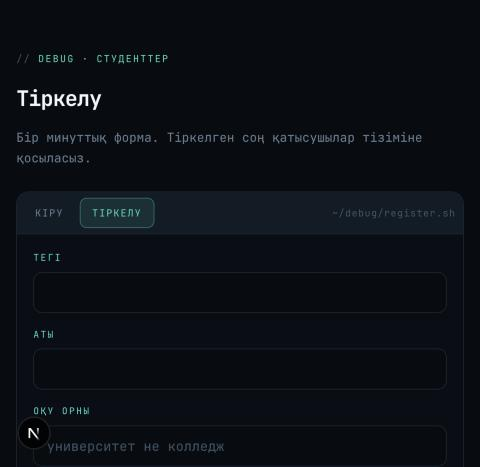 |
| Registration — field error | 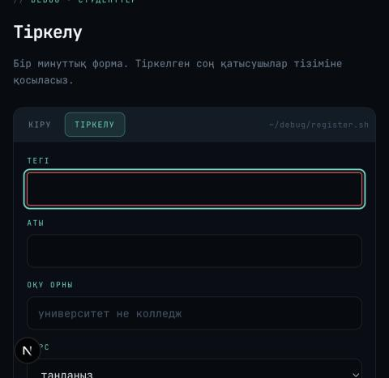 |
| Email sent state | 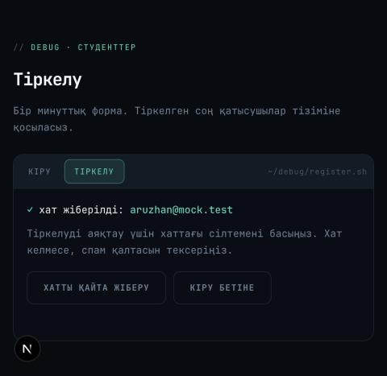 |
| `/me` after registration | 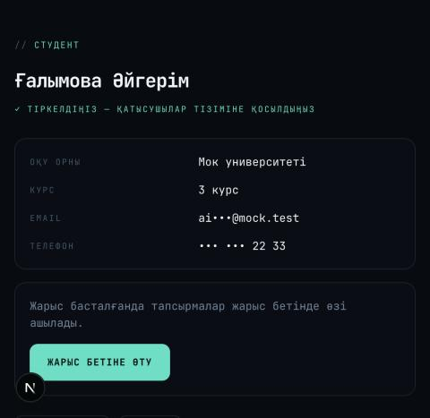 |
| Contest — waiting countdown | 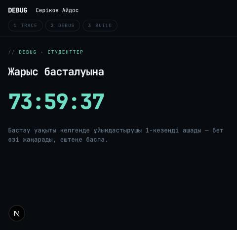 |
| Contest — Build round | 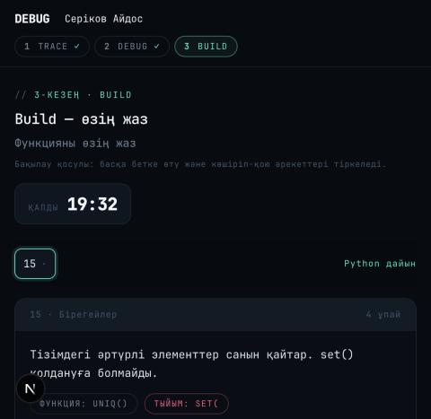 |
| Leaderboard — idle | 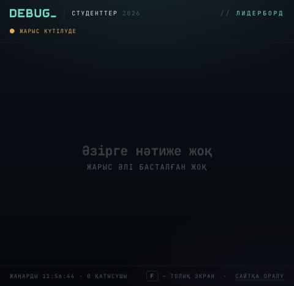 |
| Admin home | 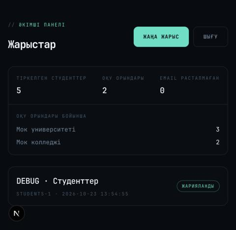 |
| Admin — no access for a student | 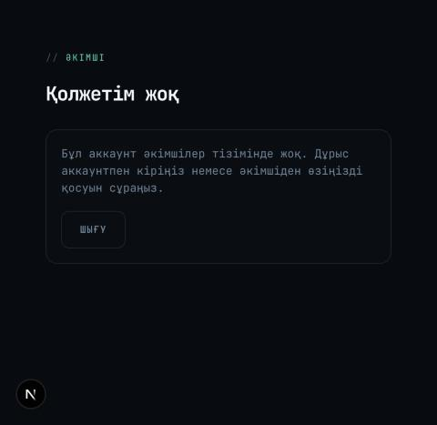 |
| Mobile 375 px — logo build | 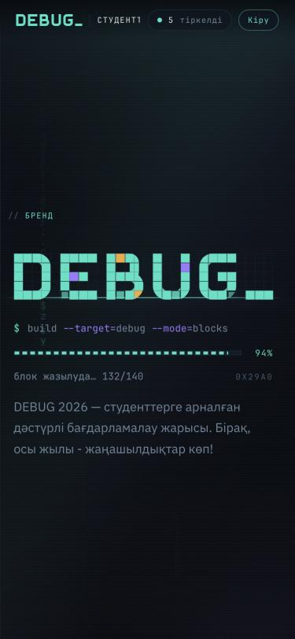 |
| Mobile 375 px — registration | 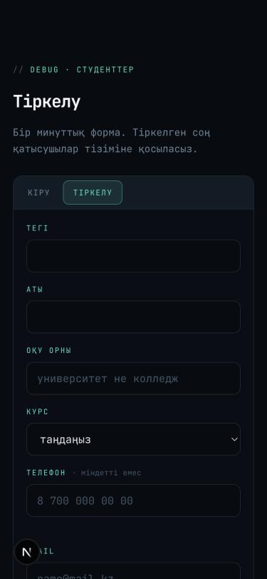 |
| New password | 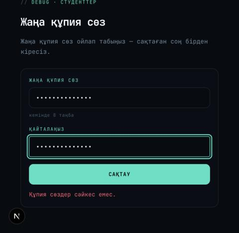 |

All names and emails in the screenshots are invented demo data.

## Do / Don't for agents

- **Do** reuse classes from `app/globals.css` (`kicker`, `h1`, `card`, `field`, `btn`, `pill`, `enter`, `shake`) and the tokens above.
- **Do** keep Kazakh copy short and direct (imperative, second person: «Тіркел», «Кіріңіз»).
- **Don't** add colours, gradients, shadows or a light theme.
- **Don't** use a font other than the two above; never load fonts from a CDN.
- **Don't** change the width of text while it animates (Decode keeps monospace width).
- **Don't** show email, phone or university anywhere public — only «Тегі Аты».
